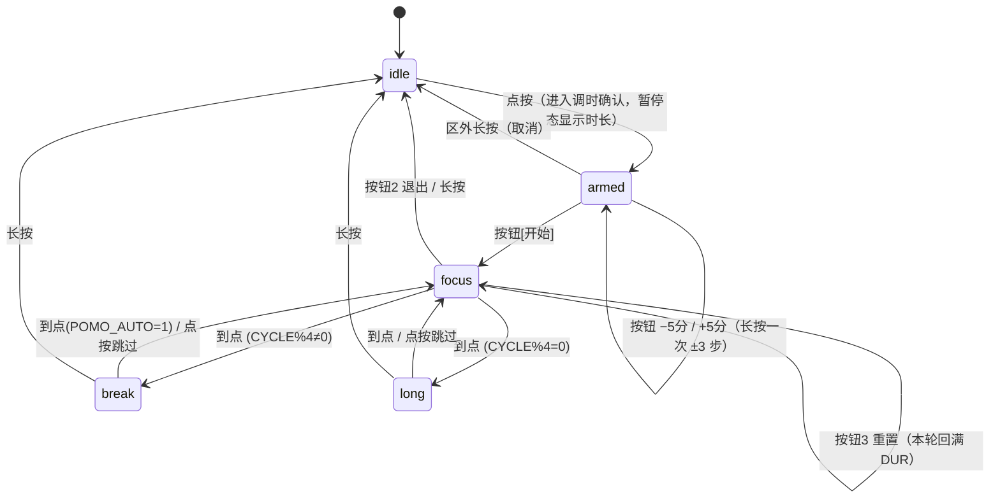

# Kindle 照片墙 · 功能详细设计

> 把一台吃灰的 Kindle Paperwhite 4 变成「照片墙 + 万年历 + 天气站 + 番茄钟」的电子墨水智能相框。
> 全部逻辑在 Kindle 上离线自治运行，无需电脑常开；手机连同一 WiFi 即可推照片、改配置、看日志。

- **目标设备**：Kindle Paperwhite 4（G000PP，1448×1072 横屏，300ppi，固件 5.12.2，已越狱）
- **运行环境**：Kindle 自带 BusyBox sh + FBInk（越狱套件附带，`/mnt/us/libkh/bin/fbink`），设备端 **零 Python / 零编译依赖**
- **文档范围**：功能设计、模块划分、关键决策与踩坑记录。安装步骤见 [README.md](README.md)。

---

## 目录

1. [设计目标与总体思路](#1-设计目标与总体思路)
2. [总体架构](#2-总体架构)
3. [设备端模块详设](#3-设备端模块详设)
4. [番茄钟子系统](#4-番茄钟子系统)
5. [交互通道（触摸 / 电源键 / FTP / Web）](#5-交互通道触摸--电源键--ftp--web)
6. [无线运维协议](#6-无线运维协议)
7. [素材与布局系统](#7-素材与布局系统)
8. [状态与数据文件](#8-状态与数据文件)
9. [关键技术问题与解法](#9-关键技术问题与解法)
10. [配置项总表](#10-配置项总表)
11. [功耗实测](#11-功耗实测)
12. [已知限制与方向](#12-已知限制与方向)

---

## 1. 设计目标与总体思路

| 目标 | 设计回应 |
|---|---|
| **离线自治** | 所有渲染、调度、交互都在设备端 shell 完成，断网只剩天气不更新，其余功能照常 |
| **手机即可运营** | 照片推送 = FTP 拖文件；改配置 = FTP 传 `.conf`；看日志 = FTP 下载。不装任何 App（FTP 客户端除外） |
| **Kindle 零依赖** | Kindle 上没有 Python、没有字体渲染、没有包管理器 → 渲染改为「电脑预制 PNG 素材 + 设备端 shell 按坐标贴图」 |
| **省电** | 墨水屏静态不耗电，耗电都在「刷新」→ 刷新间隔分级（白天/深夜/番茄钟），EPDC 空闲自动挂起，WiFi 省电模式 |
| **可退出、可恢复** | 插数据线自动退出恢复书架；电源键三连击退出；所有对系统的改动（旋转、前置灯、shadow、framework）退出时还原 |
| **抗坑** | 部署文件防半截写入（`.new` + 校验）、进程防 SIGTERM 免疫（`kill -9`）、脚本防 CRLF、framework 复活看门狗 |

**核心思路一句话**：电脑把「文字、图标、日历」全部预烘焙成 PNG 素材并生成坐标表 `layout.sh`，设备端只做「选图 → 读缓存 → 按坐标贴图 → 一次性整屏刷新」的哑渲染，从而绕开 Kindle 上缺字体、缺 Python 的一切限制。

---

## 2. 总体架构

### 2.1 宿主 / 设备分工

```
┌─────────────────────────── 电脑端（一次性） ───────────────────────────┐
│  render/make_assets.py    生成字模/图标/十年月历/坐标表（约 500 张 PNG）  │
│  render/make_v2.py        v2 版式素材 + layout-land2.sh                 │
│  render/make_pomo_ui.py   翻牌钟 UI（卡片/按钮/数字半字模/进度条）        │
│  render/batch_photos.py  照片预处理（EXIF 校正→裁切→灰度→对比度→锐化）  │
│  render/simulate.py      本地预览合成效果（改布局先看再部署）            │
└──────────────────────────────────┬─────────────────────────────────────┘
                                   │ USB 拷贝一次（后续全走 WiFi）
┌──────────────────────────────▼── Kindle 端（常驻） ─────────────────────┐
│                       /mnt/us/kindle-photo-wall/                        │
│  device/render.sh ── 主循环：屏幕所有权 / 调度 / FTP / 看门狗            │
│      ├── device/paint2.sh ── 单帧合成：照片+日历+天气+番茄钟            │
│      ├── device/pomo.sh ───── 番茄钟状态库（三进程共享）                │
│      ├── device/pomowatch.sh ─ 触摸手势监听（触摸屏 evdev）             │
│      ├── device/powerwatch.sh ─ 电源键三连击退出监听                    │
│      ├── tcpsvd+ftpd :2121 ── 手机照片通道（chroot 到 photos/）         │
│      ├── tcpsvd+ftpd :2122 ── 运维通道（根=项目目录，.new 部署协议）    │
│      └── tcpsvd+lua :8080 ─── 纪念日登记网页                            │
└─────────────────────────────────────────────────────────────────────────┘
```

### 2.2 进程与文件拓扑

```
render.sh（主循环，PID 记 device/dash.pid）
 ├── paint2.sh          每帧临时起一个，画完即退
 ├── pomowatch.sh       常驻后台，阻塞读 /dev/input/event2
 ├── powerwatch.sh      常驻后台，阻塞读 /dev/input/event1
 ├── tcpsvd :2121/2122  常驻 FTP 服务 ×2
 └── tcpsvd :8080+lua   常驻 HTTP 服务（每连接 fork lua）

共享状态（跨进程通信全部走文件）：
 device/pomodoro.state  番茄钟状态（watcher 写 → painter 读）
 device/cmd             单槽命令文件（watcher/web 写 → 主循环 5s 内执行）
 device/wx.cache        天气缓存（painter 后台刷新）
 device/dash.log        运行日志（全员写，>256KB 自动轮转）
```

设计取舍：**不用 socket / 不用信号 / 不用锁**。Kindle 上多进程协同全部退化为「原子写文件 + 轮询」，因为 mv 同分区原子、busybox 无 flock 可靠实现，且 5 秒轮询粒度对相框场景完全够用。

---

## 3. 设备端模块详设

### 3.1 `render.sh` — 主循环与系统治理（~850 行）

职责：**屏幕所有权管理** + **刷新调度** + **服务生命周期** + **退出恢复**。

#### 屏幕所有权（全项目最核心的矛盾）

| 进程 | 停/留 | 原因 |
|---|---|---|
| `framework` | **停**（`initctl stop`） | 唯一会把整屏刷成"资料库"的进程；留着画面一秒就没了 |
| `cvm` / `appmgrd` | **冻结**（SIGSTOP） | framework 停后仍会弹"应用程序出错"抢屏。**不能 kill**——本脚本挂在其进程树下，kill 会连自己带走（实测全白屏） |
| `powerd` | **留** | 管两件事：① `preventScreenSaver` 防休眠（这是唯一真正管用的开关）② USB 存储交接。停了 → 60~90s 后内核 autosleep 挂起 CPU，画面定格（"时间冻结"的真正根因） |

配套看门狗：主循环内层 5 秒一查 framework 是否复活（系统定时器/弹窗可能拉起它），复活即再停 + 立刻重画一帧盖掉弹窗残留；`cvm`/`appmgrd` 每轮补冻结。

#### 刷新调度（双层循环）

```
外层循环                          内层循环（5 秒一格）
┌─ 退出检测（USB）                 ┌─ sleep 5
├─ handle_cmd（运维命令）          ├─ 退出检测 / 番茄钟到点检测
├─ 前置灯/防休眠/固定IP 自愈  ────► ├─ handle_cmd / framework 看门狗
├─ 起一帧 paint2.sh                ├─ 心跳日志（每 15s）
└─ 进入内层等待 ────────────────── └─ 动态重算刷新间隔 _lim：
                                      专注中 = POMO_REFRESH(10s)
                                      休息中 = 60s
                                      待命   = 白天 DASH_INTERVAL / 深夜 NIGHT_INTERVAL
```

关键点一：**刷新间隔每 5 秒动态重算**。番茄钟是触摸触发的，可以在内层等待中途开始/结束——间隔若在外层只算一次，就会出现"开了番茄钟但不翻牌"的 bug。

关键点二：**待命态的节拍看时间戳，不看累计计数**。`paint2.sh` 每画一帧照片墙就更新 `device/.lastwall`（epoch 秒），内层循环在 idle 相位用 `now − lastwall ≥ 间隔` 判定刷新。若用累计计数 `_t`，进/出番茄钟会把相位变化误判成"计时清零"，每次退出都白等一个完整间隔（深夜 600s 下感受就是"照片再也不轮换了"）。番茄钟相位（专注/休息）仍用 `_t` 计数，因为翻牌节奏跟进程计时对齐更自然。

夜间模式：`NIGHT_START`(23:00) ~ `NIGHT_END`(7:00) 自动把间隔从 120s 放宽到 600s——凌晨没人看，省下的都是电。

另有 `DASH_MODE=sleep` 备用模式：RTC（`rtcwake`）定时唤醒 + `echo mem > /sys/power/state`，电池可撑数周，代价是时间最多旧一个间隔、FTP 不常开。

#### 服务生命周期

- **进程清理一律 `kill -9`**（`kill_watch_all()` 扫 `/proc/*/cmdline`）：busybox sh 对 SIGTERM **免疫**，历史遗留的监听孤儿会导致 evdev 事件人手一份（一次点按执行三遍）。
- 所有 `start_*` 从零拉起，`stop_*` 全量扫杀——pid 文件只知道最新一个，孤儿必须全量清理。

#### 退出恢复（`restore_ui`）

触发：① 插 USB（`/mnt/us` 从 `/proc/mounts` 消失，连续两次确认防抖动）② `cmd=stop`（三连击/无线运维）。
动作：停 FTP/web/watcher → 还原前置灯亮度（启动前值存 `.fl.orig`）→ 还原屏幕方向 → 解冻 `cvm`/`appmgrd` → `initctl start framework`（失败重试 6 次，仍失败 `reboot` 兜底，避免"界面停了又没人画"的白屏）。

#### 网络自愈

- **固定 IP**：给 `wlan0` 挂别名 `wlan0:0`（不动系统 WiFi 配置，那会被 wifid 覆盖），每轮循环检查补挂——掉线重连后别名消失也能自愈。
- **防火墙**：Kindle 出厂 iptables INPUT 策略是 DROP，只放行 40317；起 FTP/web 前必须补 `iptables -I INPUT` 放行 2121/2122/8080 + PASV 高端口。
- **FTP 账号**：busybox ftpd 无独立账号体系，认证走系统 `/etc/shadow` → 启动时用 `openssl passwd -1` 生成 md5-crypt hash 写入 root 行（只动密码字段、行数校验、先备份 `device/etc.shadow.bak`、标记文件防重复）。

### 3.2 `paint2.sh` — 单帧合成引擎（~990 行）

职责：一帧画面 = **40~60 张素材按坐标贴图 + 一次整屏刷新**。纯函数式：读状态文件 → 画 → 退出，无任何常驻状态（跨帧状态全在 dot 文件里）。

#### 渲染管线（照片墙版式）

```
1. clear framebuffer（fbink -b -c）
2. 番茄钟专注中？→ 整屏交给 paint_pomo_focus，直接返回
3. 选照片 → contain 等比贴进照片框（上下留白动态分配给信息带）
4. 上信息带：日期 / 星期 / 农历·节气 / 每日一句（按年内第几天取，207 条）
5. 下信息带：时钟(HH:MM) / 天气图标+温度+描述 / 湿度 / 空气质量
6. 右侧栏 420px：月历(预烤十年模板+今日高亮+纪念日框) / 日出日落 /
                临近节日倒计时 / 纪念日 / 明日·后日预报 / 电量
7. 最后一个 stamp 触发整屏刷新（fbink -s -W GL16/GC16）
```

#### 贴图原语

- `stamp file x y`：`fbink -b -g file=,x=,y=` 贴图不刷新
- `stamp_last`：最后一笔，先 `echo 0 > fb0/blank`（blank 状态下驱动静默丢 update），再刷。**波形策略**：第 1 帧 / 每 `FULL_EVERY`(10) 帧 / 番茄钟换相 → GC16 全刷清残影；其余 GL16 轻刷不闪
- `img_dims`：dd 读文件头解析 PNG IHDR / JPEG SOF 得到宽高（先 32KB，解析不出再 128KB），**不依赖 file/identify**

#### 文字系统（三级字库）

Kindle 无字体渲染 → 所有文字是电脑预烘焙的 PNG：

| 层级 | 目录 | 内容 | 用法 |
|---|---|---|---|
| 数字库 | `v2_digits/<size>/` | 0-9、`:`、`-`、`%`、`°` 等按档位(date/time/temp/small/tiny/huge)分目录 | `draw_num2`，宽度查 `layout.sh` 的 `DIGIT_W_*` |
| 词模库 | `v2_cn/<size>/` | 常用整词（"星期一"、"湿度"、"休息中"…）整词一张图，步进=字数×字号 | `draw_cn2`，词模没收录自动降级单字 |
| 单字库 | `v2_chars/` | 每个字一张图，兜底渲染任意文本（用户自定义纪念日名） | `draw_chars`，UTF-8 安全逐字切分 |

细节：FAT32 大小写不敏感 → ASCII 字母按字节值存名（`l97`=w、`u65`=W）；busybox 按字节做 `${s#?}` 会切坏汉字 → `take_char` 按首字节判 UTF-8 长度（1/2/3 字节）。

#### 照片轮换策略（`pick_photo`）

```
新照片优先：ls -t 前 6 张中 mtime 距今 ≤ PHOTO_NEW_WINDOW(650s) 的最新一张
            → 保证"手机传完，最迟 10 分钟内一定上屏"（覆盖夜间慢节奏）
常规轮换：  epoch / PHOTO_ROTATE_SEC(60) % 总张数 → 每分钟换一张、顺序稳定可复现
PHOTO_ROTATE_SEC=0 → 按 年内天 % 张数，"每天一张"相框模式
```

照片无需预处理尺寸：`img_dims` 读出宽高后 contain 等比缩放贴图（fbink 负责缩放），尺寸缓存 `.photo.dims`。

#### 天气子系统（`get_wx`）

- 主源 **Open-Meteo**（按经纬度，含 3 日预报/日出日落/湿度），辅源 **itboy 中国天气**（城市码，纯 HTTP）。
- 缓存 `wx.cache` 45 分钟内直接用；**有旧缓存时后台刷新**（`.new` 临时文件 + mtime>180s 防叠加），首帧立即出画——这是"重新进照片墙空白几十秒"问题的修复，冷缓存才同步等待。
- AQI 单独走 `air-quality-api.open-meteo.com`，失败不影响主流程；AQI 数值→优/良/轻度/中度/重度。
- JSON 解析用 grep/sed/awk 纯 shell（无 jq），WMO weather_code → 中文描述+图标的映射表内置。

#### 日历 / 农历 / 节日 / 纪念日

- **月历**：电脑端预烤 2026–2035 十年 120 张月历 PNG（`cal2/YYYY-MM.png`），设备端只贴图 + 算今日格子坐标画高亮块；纪念日画空心框。
- **农历**：电脑端逐年生成 `lunar/YYYY.txt`（每天一行 `MMDD|月名|日名|节气`），设备端 `grep` 当天——避开设备端农历算法。
- **节日**：`fest.txt`（2020–2040 按日期排序），设备端向后扫取最近三条做倒计时。
- **纪念日**：`anniversaries.conf`（支持公历+农历生日，农历生日每年按农历换算成公历日期），通过 8080 网页登记（见 §5.4）。

### 3.3 `paint.sh` — v1 竖屏版式

旧版竖屏布局（照片在上、信息在下），保留作兼容；`LANDSCAPE=0` 时自动回退。与 v2 共享贴图原语、天气、照片选择逻辑。

---

## 4. 番茄钟子系统

照片墙待命 = 番茄钟待命：点按屏幕任意处开始专注，无需任何额外硬件。

### 4.1 状态机（`pomo.sh`，三进程共享的纯函数库）



**为什么要 armed 阶段**：专注时长不写死——点按先进入「调时确认」暂停态（翻牌钟静止显示 `DUR:00`），用 ±5 分按钮调整到想要的时长（如 45 分钟），按「开始」才正式倒计时。所选时长写入状态文件 `DUR` 字段**跨会话记忆**（下次点按还是 45），重置按钮也按 DUR 回满。

状态文件 `device/pomodoro.state`（原子写：写 `.tmp` 再 `mv`）：

```
PHASE=idle|focus|break|long   当前阶段
END=<epoch 秒>                 本阶段结束时刻（运行中有效——绝对时间戳，
                               暂停时换算成 LEFT 存起来，恢复时倒推回 END，
                               进程重启/部署/断电都天然无损）
PAUSED=0|1                     暂停标记（仅专注）
LEFT=<秒>                      暂停时剩余
ARMED=0|1                      调时确认态（focus 的暂停子态，按钮义为 −5/开始/+5）
DUR=<分钟>                     本轮专注时长（±5 调整，跨会话记忆，1..99）
CYCLE=<n>                      本组已完成番茄数（决定短休/长休）
TODAY / DAY                    今日完成数 / 归属日期（跨天自动清零）
```

`render.sh` 的 `pomo_tick()` 在 5 秒粒度循环里检测 `now ≥ END` 并推进相位（写 `.pomo.flash` 标记让下一帧强制 GC16 全刷，提示"翻页感"）。

### 4.2 触摸监听（`pomowatch.sh`）

- 直接阻塞读触摸屏 evdev（`/dev/input/event2`，goodix-ts）：`dd bs=16 count=1` 恰好一条事件（`cat|od` 会攒 4K 缓冲，绝对不行），空闲零轮询零耗电。
- **事件识别**：按下 = EV_ABS code 53/54（POSITION_X/Y），抬起 = code 57 value 全 255（TRACKING_ID=-1）。本机无 BTN_TOUCH，全靠 MT 事件判断。
- **坐标系映射**（重点坑）：goodix 报**竖屏原始坐标**（rawX∈[0,1071]，rawY∈[0,1447]），画面横屏 1448×1072。实测校准（用户按三颗按钮反推）：

  ```
  屏幕X = rawY          （不镜像——镜像过一次，左右按钮正好对调、中间不受影响，极难发现）
  屏幕Y = 1071 − rawX
  → POMO_TOUCH_MAP=5，map_xy 留 6 种映射可切换
  ```

- **手势按状态收敛**（专注页只认按钮，防误触）：

| 状态 | 点按 | 长按(≥800ms) |
|---|---|---|
| idle | 任意处：进入调时确认（armed） | 忽略 |
| armed（调时页） | 只认三按钮：左 −5分 / 中 开始 / 右 +5分；区外忽略 | ±键一次 ±3 步；中键=开始；区外=取消回照片墙 |
| focus | 只认三按钮热区；按钮1=暂停/继续（同键双态，画面对应换图）；按钮2=退出；按钮3=重置（本轮回满 DUR，轮次/今日数不变）；区外忽略 | 区内按按钮、区外忽略 |
| break/long | 任意处：跳过休息进专注 | 结束回照片墙 |

- 反馈链路：改状态 → `fbink -q` 立即打一行 ASCII 确认（fbink 内置字体无中文）→ 写 `cmd=paint`，主循环 ≤5s 内重画完整画面。

### 4.3 翻牌钟 UI（`paint_pomo_focus`）

```
┌────────────────────────────────────────────────┐
│ 第 1/4 轮·FOCUS          timer.running = false  │  ← 轮次徽章 / 运行状态灯（调时页恒 false）
│   ┌────────┐   ══   ┌────────┐                 │
│   │  25    │  (axle)│  00    │  黑卡白字=分钟   │  ← flip-clock 双卡片
│   └────────┘        └────────┘  白卡黑字=秒    │
│        [ ░░░░░░░░░░░░ ] 0%                     │  ← 14 格进度条（调时页恒 0）
│   🍅 番茄 1        ✔ 今日已完成 2 个            │
│   ( −5分 )     ( 开始 )      ( +5分 )           │  ← 调时页按钮（armed 态）
│   ( 休息 )     ( 退出 )      ( 重置 )           │  ← 运行页按钮（同热区换义换图）
└────────────────────────────────────────────────┘
```

- **调时确认页（armed）**：进入即暂停态，翻牌钟静止显示所选时长；三颗按钮换成 −5分/开始/+5分（同一热区、不同素材图），长按 ± 一次 ±3 步快速跳到 45/90；按「开始」→ `END=now+LEFT` 正式开跑。右上角 `timer.running=false` + 进度 0% 天然表达"未开始"。
- **翻牌动画**：每位数字有整字图 + 上半 `_t.png` / 下半 `_b.png`（卡缝对齐处切分）。值变化时先贴**混合帧**（新数字上半 + 旧数字下半 + 翻板边线）→ 局部刷新 → 停 `POMO_FLIP_DELAY`(0.4s) 让翻板"落下" → 再落定完整新帧。逐数位比对（`flip_digits`），十位没变只翻个位；调时页 ± 步进同样走这套动画（END 恒 0 = 同会话）。
- 动画条件：与 `.pomo.flipval`（存上一帧 END/MM/SS）比对，**同会话（END 相同）才动画**——跨重启/新会话直接落定不误翻；暂停态值不变自然不翻。
- 秒钟每 `POMO_REFRESH`(10s) 翻一次（真实翻牌钟节奏，也把刷新耗电控制在 47mA）；暂停/休息 60s 一帧；**数字最后画**——混合帧局部刷新时整幅画面已是新值，视觉上只有卡片在翻。
- 休息阶段不占屏：照片墙照常轮换，左上角叠"休息中 MM:SS"徽章。

---

## 5. 交互通道（触摸 / 电源键 / FTP / Web）

| 通道 | 硬件依赖 | 用途 | 耗电 |
|---|---|---|---|
| 触摸屏 evdev | goodix-ts | 番茄钟全部操作 | 阻塞读，零轮询（3 分钟 CPU 累计 10ms） |
| 电源键 evdev | bd71827-power | 三连击退出（不依赖 WiFi/USB 的物理退出） | 同上 |
| FTP :2121 | WiFi | 手机推/删照片（根目录=photos/） | 按需连接 |
| FTP :2122 | WiFi | 无线运维：看日志、改脚本、重启、停止 | 按需连接 |
| HTTP :8080 | WiFi | 纪念日登记表单（无需 FTP 客户端） | 按需连接 |

### 5.1 电源键三连击（`powerwatch.sh`）

照片墙运行时 `preventScreenSaver=1` 挡着，电源键短按**本来就不休眠**——正好利用这个"空转"做退出手势：3 秒内连按 3 次 → fbink 先打 "Exiting photo wall..."（framework 重启要 10~30s，不提示会以为没反应）→ 写 `cmd=stop`。次数/窗口可配（`POWER_EXIT_PRESSES` / `POWER_PRESS_WINDOW`），`POWER_EXIT=0` 关闭。

### 5.2 手机照片通道（FTP :2121）

- `tcpsvd 0.0.0.0 2121 busybox ftpd -w photos/`——**根目录就是照片目录**，图库"分享→FTP"正好落进来，不用进子目录。
- 上传即入库：`pick_photo` 下一帧（≤60s，深夜 ≤10min）优先显示。
- 认证：复用系统 root 账户（见 §3.1 FTP 账号），密码 `FTP_PASS` 可改。

### 5.3 运维通道（FTP :2122）

根目录 = 整个项目目录。与 :2121 分离的原因：手机通道被 chroot 在 photos/ 够不到脚本和日志，而运维通道**有写权限**——不想要的场景 `ADMIN_PORT=0` 一键关闭。电脑端配套 `tools/wireless.sh`：`log / grep / deploy / restart / stop / ls / get` 一条命令完成（见 §6）。

### 5.4 纪念日网页（`device/web/anniv.lua`）

设备无 httpd → BusyBox `tcpsvd` + Lua 5.1 现搭：每连接 fork 一个 lua 进程，读请求 → 改 `anniversaries.conf` → 写 `cmd=paint`（≤5s 重绘）。手机浏览器直接填表，零安装。名称限 40 字节（≈13 汉字，受单字图集覆盖范围约束）。

---

## 6. 无线运维协议

### 6.1 单槽命令文件 `device/cmd`

任何进程写一行命令进去，主循环 5 秒内执行并删除。**单槽**：触摸触发的重绘会覆盖远程命令——已知取舍，相框场景可接受。

| 命令 | 动作 |
|---|---|
| `paint` | 立刻重画一帧（网页保存纪念日后用） |
| `restart` | `exec` 换掉自己：PID 不变，env 重读 |
| `deploy` | 应用所有 `*.new` → 重启（见下） |
| `unpack` | 解压 `assets2.tgz` 素材包（换布局用） |
| `stop` | 恢复原生界面退出 |
| `probe` / `fbrot` / `shcmd` | 摸底诊断 / 旋转能力探测 / 应急执行 `shell.cmd` |

### 6.2 `.new` 部署协议（防半截写入）

FTP 上传是「截断再写」，正在运行的脚本被直接覆盖会被 shell 读到半截当场崩溃。所以：

```
电脑端: ftp_put 新脚本 → xxx.sh.new
        ftp_put 一行 "deploy" → device/cmd
设备端: apply_new() 逐个校验:
          ① CRLF 检查（字节数对比，Windows 行尾会让坐标/字符串全废）
          ② sh -n 语法检查
        通过 → mv .new 正式名 → exec 重启自身 → 新代码生效
```

### 6.3 `tools/wireless.sh`（电脑端 CLI）

```
sh tools/wireless.sh log 60                  # 看日志末尾
sh tools/wireless.sh deploy device/paint2.sh device/env.conf
sh tools/wireless.sh restart | stop | ls | get device/dash.log
```

双 IP 自动探测（固定别名 + DHCP 地址），全程 curl 实现，无需 FTP 客户端。

---

## 7. 素材与布局系统

### 7.1 布局常量（`assets/layout-land2.sh`）

**坐标即代码**：每个元素的 x/y/w/h、每档字号的数字宽、词模步进，全部集中在一个 shell 变量文件里，被 `paint2.sh`/`pomowatch.sh` source。改布局 = 改常量 + 重跑生成器，两端（生成器/设备）永远同一份坐标，杜绝"预览和真机对不上"。

### 7.2 生成器（电脑端，Pillow）

| 生成器 | 产物 |
|---|---|
| `render/make_assets.py` | 基础字模/图标/月历框架（`py -3.11`，注意本机默认 3.13 无 Pillow） |
| `render/make_v2.py` | v2 版式全套：`v2_digits`/`v2_cn`/`v2_chars`/`v2_icons`/`v2_hl`/`cal2` + `layout-land2.sh` |
| `render/make_pomo_ui.py` | 翻牌钟：卡片/转轴/按钮（含调时态 −5分/开始/+5分，文字 mm 居中）/进度条/数字半字模（卡缝对齐）/轮次徽章 |
| `render/simulate.py` `tools/preview_pil.py` | 本地 PIL 复现一帧（读同一份 layout），**改任何布局先本地预览再部署** |

### 7.3 素材总量

约 500 张 PNG：数字 6 档 × 全符号、常用词模数百条、单字图集（纪念日名兜底）、天气图标 11 种、月历 120 张（2026–2035）、每日一句 207 条、翻牌钟 UI 50+ 张。全部 FAT32 兼容命名（大小写不敏感问题见 §3.2）。

---

## 8. 状态与数据文件

| 文件 | 读写方 | 生命周期 |
|---|---|---|
| `device/pomodoro.state` | pomo 库（三进程） | 原子写；跨重启保活 |
| `device/cmd` | watcher/web 写 → render 读删 | 单槽，5s 消费 |
| `device/wx.cache` | paint2 写读 | 45min TTL，后台刷新 |
| `device/.pomo.flipval` | paint2 写读 | 翻牌动画比对（同会话才翻） |
| `device/.photo.dims` | paint2 写读 | 照片尺寸缓存（键=路径:mtime-size） |
| `device/.count` | paint2 写读 | 帧计数（GC16 节奏） |
| `device/.fl.orig` `.rotate.orig` | render | 启动前原值，退出还原 |
| `device/etc.shadow.bak` | setup_ftp_auth | 首改 shadow 前备份 |
| `device/dash.log`（+`.1`） | 全员 | >256KB 轮转 |
| `device/anniversaries.conf` | web 写 → paint2 读 | 每帧重读 |
| `photos/` | FTP 写 → paint2 读 | 照片池=FTP 根目录 |

---

## 9. 关键技术问题与解法

> 这一节是全项目的"经验密度"所在——每一条都是真机上实测踩出来的。

| # | 问题 | 现象 | 解法 |
|---|---|---|---|
| 1 | **屏幕所有权** | 画面一秒被书架盖掉；或 60s 后时间冻结 | 停 framework + 留 powerd + 冻结 cvm/appmgrd（不能 kill，见 §3.1） |
| 2 | **busybox sh SIGTERM 免疫** | 历史上所有"杀旧进程"静默失效，孤儿监听进程一次点按执行多遍 | 一律 `kill -9` + `/proc` 全量扫描 |
| 3 | **刷新不生效** | `eips -f` 只第一次有效，之后被 MTK 屏控静默丢 | 必须用 `fbink -s`（整屏刷当前帧缓冲）；刷新前 `echo 0 > fb0/blank` |
| 4 | **触摸坐标系** | 按钮"没反应"或左右对调 | goodix 报竖屏原始坐标 → 屏幕X=rawY（不镜像）、Y=1071−rawX；校准必须用**不同水平位置**的多点（中线元素对镜像错误不敏感） |
| 5 | **evdev 只读** | dd 写事件 rc=0 但被静默吞 | Kindle 内核不支持事件注入，测试只能真人手指 |
| 6 | **半截脚本猝死** | FTP 直接覆盖运行中脚本 → shell 读到一半崩溃 | `.new` + CRLF/sh -n 校验 + deploy 原子替换 |
| 7 | **重进白屏几十秒** | 天气同步等 15~40s 才出首帧 | 旧缓存立即出画 + 后台刷新缓存 |
| 8 | **FAT32 大小写不敏感** | `ww` 字模显示成 `WW` | ASCII 字模按字节值命名 `l97`/`u65` |
| 9 | **UTF-8 切字** | busybox `${s#?}` 按字节切，汉字切半个 | `take_char` 按首字节判长度（<128=1、<224=2、否则 3 字节） |
| 10 | **防火墙** | FTP 起来了手机就是连不上 | Kindle iptables INPUT 默认 DROP，必须补放行规则 |
| 11 | **时区** | 设备时钟 UTC，时间差 8 小时 | `TZ=CST-8` POSIX 串导出，不依赖 zoneinfo |
| 12 | **USB 误判** | 拔线瞬间启动会误判"插着电脑"立刻退出 | 等 `/mnt/us` 挂载回来（≤30s）+ 连续两次判定确认 |

---

## 10. 配置项总表（`device/env.conf`）

| 分组 | 键 | 默认 | 说明 |
|---|---|---|---|
| 天气 | `CITY_CODE` / `LAT` / `LON` | 101010100 / 39.9042 / 116.4074 | itboy 城市码 / Open-Meteo 经纬度（示例：北京，改成自己的城市） |
| 调度 | `DASH_MODE` | always | always=常亮；sleep=RTC 休眠（数周续航） |
| | `DASH_INTERVAL` / `NIGHT_*` | 120 / 23,7,600 | 白天秒数 / 夜间起止与间隔 |
| 版式 | `PAINT_SH` / `LANDSCAPE` / `FB_ROTATE` | paint2.sh / 1 / 0 | 版式脚本 / 横屏开关 / 旋转值（画面倒了改 2） |
| 刷屏 | `WAVE` / `WAVE_FULL` / `FULL_EVERY` | GL16 / GC16 / 10 | 平时轻刷 / 清残影全刷 / N 帧一次 |
| 系统 | `STOP_UI` / `FREEZE_APP` / `STOP_POWERD` | 1 / 1 / 0 | 屏幕Ownership 三开关（见 §3.1，一般不动） |
| 省电 | `WIFI_POWERSAVE` / `EPDC_POWER` / `FRONTLIGHT` | 1 / auto / 0 | WiFi 省电 / EPDC 挂起 / 前置灯亮度 |
| 照片 | `PHOTO_ROTATE_SEC` / `PHOTO_NEW_WINDOW` / `PHOTO_FIT` | 60 / 650 / contain | 轮换间隔（0=每天）/ 新图优先窗 / contain\|cover |
| FTP | `FTP_PORT` / `FTP_USER` / `FTP_PASS` / `FTP_AUTH` | 2121 / root / root / 1 | 手机通道（密码写入系统 shadow，见 §3.1） |
| 运维 | `ADMIN_PORT` | 2122 | 0=关闭；有写权限，按需 |
| Web | `ANNIV_WEB` / `ANNIV_WEB_PORT` | 1 / 8080 | 纪念日登记网页 |
| 电源键 | `POWER_EXIT` / `POWER_EXIT_PRESSES` / `POWER_PRESS_WINDOW` | 1 / 3 / 3 | 三连击退出 |
| 番茄钟 | `POMO` / `POMO_FOCUS` / `POMO_STEP` / `POMO_BREAK` / `POMO_LONG` / `POMO_EVERY` / `POMO_AUTO` | 1 / 25 / 5 / 5 / 15 / 4 / 1 | 开关 / 调时页初始分钟 / ±5 步长（标签烤死 ±5分）/ 短休 / 长休 / 长休间隔 / 自动下一轮 |
| | `POMO_REFRESH` / `POMO_FLIP` / `POMO_FLIP_DELAY` / `POMO_TOUCH_MAP` | 10 / 1 / 0.4 / 5 | 翻牌节奏 / 动画开关 / 落牌停顿 / 坐标映射 |
| 网络 | `FIXED_IP` / `FIXED_MASK` | 192.168.0.250 / 24 | wlan0 别名，选 DHCP 池外地址 |

---

## 11. 功耗实测

设备：PW4，电池 1505mAh，WiFi 省电 on + EPDC auto，前置灯 0。

| 场景 | 平均电流 | 续航估算 |
|---|---|---|
| 待命（照片墙 120s 一帧 + 三监听进程） | **12~12.5mA** | **约 5 天**（监听进程阻塞读 evdev，3 分钟 CPU 累计仅 10ms） |
| 番茄钟专注（10s 翻牌 + 动画） | **47mA** | 每个番茄 ≈20mAh ≈1.3% 电量；日均专注 2h → 续航约 16 天 |
| 优化前对照 | 静置 41~73mA | WiFi 省电 off+EPDC on 时 20h；两项优化后 5 天+ |

耗电大头永远在「刷新」：GL16 一帧约 0.2mAh，GC16 更高。降 `POMO_REFRESH` 到 30/60 可把专注耗电降 2/3。

---

## 12. 已知限制与方向

**限制**
- 天气依赖两个免费 HTTP 源，纯局域网外不可更新（照片墙其余功能照常）
- 中文显示依赖预烘焙字库，新词组需重跑生成器部署素材包
- `cmd` 单槽：触摸重绘命令可能覆盖远程命令
- 触摸映射基于 PW4 goodix 实测，其他机型可能要换 `POMO_TOUCH_MAP`
- FTP/运维通道仅限可信家庭局域网（2122 有整项目写权限）

**可能的迭代方向**
- 更多机型适配表（触摸映射 / input 节点自动探测已有，需真机数据）
- 休眠模式（`DASH_MODE=sleep`）与常亮模式的自动切换（按作息）
- 番茄钟统计沉淀（TODAY 已有，可加周/月聚合显示）
- 素材包 OTA：`unpack` 命令已支持，可加版本校验

---

*文档对应代码版本：2026-11（调时确认页 armed + 触摸校准 map=5 后）。模块行数、常量名以仓库实际代码为准。*
