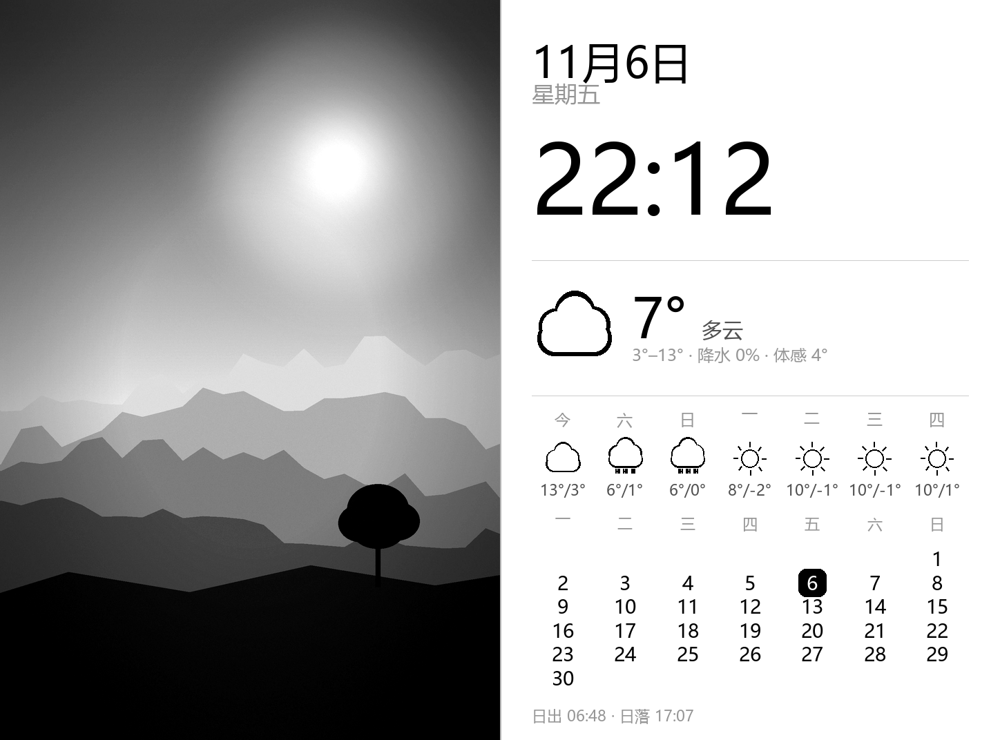
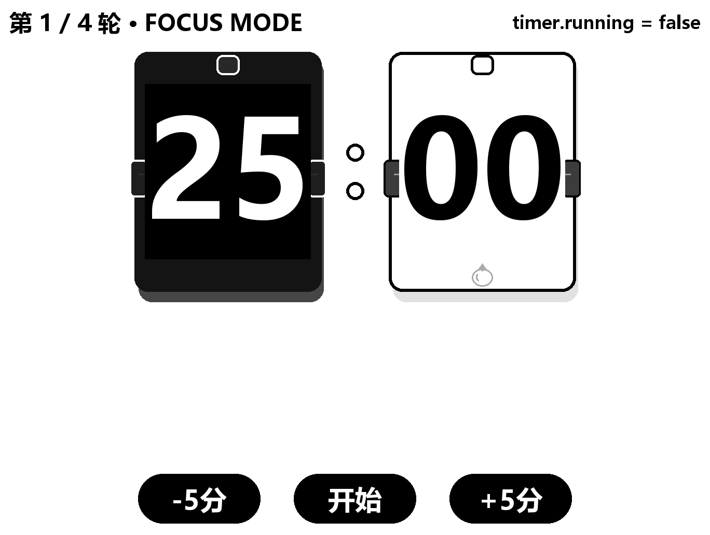

# Kindle 照片墙（电子墨水相框 + 万年历 + 番茄钟）

**Kindle Photo Wall** — 把吃灰的 Kindle Paperwhite 变成一面会自我管理的电子墨水相框：
照片轮换 + 万年历（农历/节气/节日/纪念日）+ 天气 + 每日一句，还有一个 **flip-clock 翻牌番茄钟**。
全部逻辑在 Kindle 上以 BusyBox shell 实现，**离线自治运行，不需要电脑常开**。



> 横屏 1448×1072（300ppi）。左侧照片（手机 FTP 推送，刚传的优先显示），
> 上下信息带：日期 / 星期 / 农历节气 / 每日一句 / 时钟 / 天气 / 湿度 / 空气质量，
> 右侧栏：月历（今日高亮 + 纪念日标框）/ 日出日落 / 临近节日倒计时 / 纪念日 / 明后日预报 / 电量。

## 功能特性

| 功能 | 说明 |
|---|---|
| 🖼 照片轮换 | 手机 FTP 直传（根目录=照片目录），刚上传的优先显示，之后按分钟/按天轮换 |
| 📅 万年历 | 预烤十年月历（2026–2035）、今日反白高亮、农历生日换算、节日倒计时 |
| ⛅ 天气 | Open-Meteo 主源 + 中国天气备用源，45 分钟缓存后台刷新，含 AQI/日出日落/三日预报 |
| 📖 每日一句 | 207 条预烤语料，按年内第几天轮换 |
| 🍅 翻牌番茄钟 | 点按屏幕进入**调时确认页**（−5分/开始/+5分，长按±=±15），按开始才倒计时；时长跨会话记忆；逐位翻牌动画 |
| 🔋 电量显示 | 每帧读取 sysfs，充电时附"充电中" |
| 📶 无线运维 | 第二个 FTP 通道 + 单行命令协议：改脚本/看日志/重启/停止都不用插线 |
| 🌐 纪念日网页 | Kindle 上用 tcpsvd+Lua 现搭的 8080 端口表单页，手机浏览器直接登记特殊日子 |
| ⏻ 物理退出 | 电源键 3 秒内三连击退出照片墙（不依赖 WiFi/USB） |
| 🔇 省电 | 待命实测 ~12.5mA（约 5 天续航）；夜间自动放慢刷新；EPDC 空闲挂起 |

翻牌番茄钟（调时确认页，暂停态显示时长）：



## 工作原理

```
┌────────────────────────── 电脑端（一次性） ──────────────────────────┐
│  render/make_*.py    预烘焙全部素材（约 500 张 PNG：字模/图标/月历）   │
│  render/batch_photos.py  照片预处理（裁切/灰度/对比度）               │
│  render/simulate.py  本地预览（改布局先看再部署）                     │
└─────────────────────────────────┬────────────────────────────────────┘
                                  │ USB 拷贝一次，之后全走 WiFi
┌───────────────────────────────▼── Kindle 端（常驻） ──────────────────┐
│  render.sh     主循环：屏幕所有权 / 刷新调度 / FTP / 看门狗            │
│  paint2.sh     单帧合成：选图→读缓存→按坐标贴 40~60 张素材→一次整屏刷新│
│  pomo*.sh      翻牌番茄钟（状态文件驱动，触摸 evdev 手势）             │
│  tcpsvd :2121  手机照片通道（FTP，根目录=photos/）                    │
│  tcpsvd :2122  无线运维通道（FTP + 命令协议）                         │
│  tcpsvd :8080  纪念日登记网页（Lua）                                  │
└───────────────────────────────────────────────────────────────────────┘
```

Kindle 上没有 Python、没有字体渲染 → 所有文字/图标/日历由电脑预烘焙成 PNG，
设备端只做「按坐标贴图 + 一次整屏刷新」。坐标与字号集中定义在 `assets/layout-land2.sh`，
生成器与设备端共用同一份坐标，改布局不会"预览和真机对不上"。

**为什么这样设计**（屏幕所有权、busybox 陷阱、触摸坐标校准、波形策略……12 个真机踩坑与解法）
详见 **[DESIGN.md](DESIGN.md)**（功能详细设计）。

## 目录结构

```
kindle-photo-wall/
├── device/              设备端脚本（拷到 Kindle /mnt/us/kindle-photo-wall/device/）
│   ├── render.sh        主循环
│   ├── paint2.sh        v2 横屏合成（paint.sh=v1 竖屏，自动回退）
│   ├── pomo.sh          番茄钟状态库
│   ├── pomowatch.sh     触摸手势监听
│   ├── powerwatch.sh    电源键三连击退出
│   ├── env.conf         配置（不入库，有 env.conf.example 模板）
│   └── web/anniv.lua    纪念日网页
├── assets/              设备端素材目录（在 Kindle 上；仓库根的 assets2.tgz 即其打包）
├── render/              电脑端生成器（make_assets/make_v2/make_pomo_ui/batch_photos/simulate）
├── tools/               预览、调试、无线运维 CLI
└── docs/                设计文档与截图
```

## 快速开始

前提：Kindle Paperwhite（本机 PW4 / 固件 5.12.2 实测）已越狱，且有 FBInk
（[WinterBreak](https://www.mobileread.com/forums/showthread.php?t=355803) 越狱套件附带 `/mnt/us/libkh/bin/fbink`）。

1. **拷贝**：整个目录拷到 Kindle 的 `/mnt/us/kindle-photo-wall/`
2. **配置**：`cp device/env.conf.example device/env.conf`，改城市经纬度、FTP 密码
3. **照片**：`render/batch_photos.py` 批量处理（或直接丢原图，设备端会自适应缩放）到 `photos/`
4. **启动**：资料库里点「照片墙 - 启动」（或 `sh device/render.sh &`）
5. 手机 FTP 连 `ftp://<kindle-ip>:2121` 推照片；浏览器开 `http://<kindle-ip>:8080/` 登记纪念日

素材以 **`assets2.tgz`** 随仓库附带（= `render/assets/` 的打包，5700+ 张 PNG）。
部署：把 `assets2.tgz` 放到 Kindle 项目根目录（无线运维 FTP 直传即可），
发一条 `unpack` 命令即解包到 `assets/`；也可以本地 `py -3.11 render/make_v2.py`
重新生成（依赖 Windows 字体）。改版式/字样：改 `render/make_*.py` 顶部常量 →
重新生成 → `render/simulate.py` 本地预览 → 重新打包部署。

## 电脑端依赖

- Python 3.11 + Pillow（素材生成/照片处理/预览）
- 无其他依赖；设备端零安装

## 番茄钟用法（触屏）

| 状态 | 点按 | 长按(≥1s) |
|---|---|---|
| 照片墙待命 | 任意处 → 进入调时确认页 | — |
| 调时页 | 左 −5分 / 中 开始 / 右 +5分 | ±键=±15分；区外=取消 |
| 专注中 | 按钮1 暂停/继续 | — |
| 专注中 | 按钮2 退出 / 按钮3 重置（回满所选时长） | 区外忽略 |
| 休息中 | 任意处 → 跳过休息 | 结束回照片墙 |

## 无线运维（不插线改脚本）

```
sh tools/wireless.sh log 60                          # 看日志
sh tools/wireless.sh deploy device/paint2.sh assets/layout-land2.sh
sh tools/wireless.sh restart | stop | ls | get device/dash.log
```

原理：脚本传成 `xxx.new`，写一行 `deploy` 到 `device/cmd`；设备端校验
（CRLF / `sh -n`）→ 原子替换 → 自重启。绝不直接覆盖运行中的脚本。

## 已知限制

- 触摸坐标映射按 PW4 goodix 实测校准（`POMO_TOUCH_MAP`），其他机型可能需要换映射
- 天气依赖两个免费 HTTP 源；纯局域网外不更新（其余功能照常）
- 中文显示依赖预烘焙字库，新词组需重跑生成器
- FTP/运维/网页通道仅限可信家庭局域网

## 文档

- **[DESIGN.md](DESIGN.md)** — 功能详细设计（架构 / 模块 / 状态机 / 踩坑实录 / 配置总表 / 功耗实测）

## License

[MIT](LICENSE)
